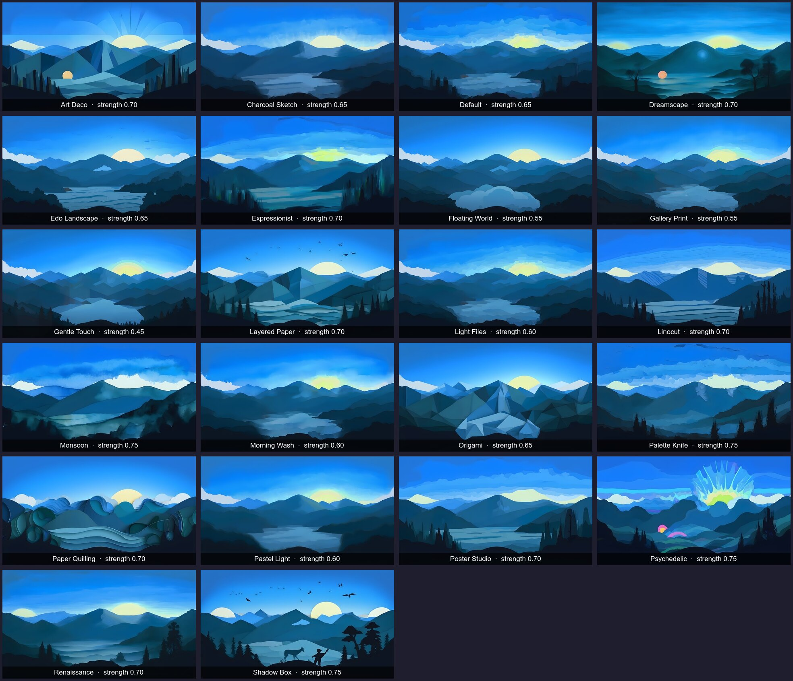

# kiro-atelier-wallpapers

Twenty-two wallpapers that show what **Kiro Atelier** (KA) can do: one picture, painted in 22 of KA's styles,
each in 4K (one style, Light Files, in 1920 × 1080). They ship on the Kiro ISO and show up in Variety's rotation.



**Kiro Atelier** turns your photos and wallpapers into paintings on your own computer, with no cloud and no account:
oil impasto, palette knife, watercolour, pastel, Japanese woodblock, linocut, charcoal, paper craft and more.
Check first whether your PC can run it with the free [KA Check](https://github.com/kirodubes/kiro-atelier-check),
then get it here: [Kiro Atelier on Ko-fi](https://ko-fi.com/s/6ff5175237).

## What it ships

- `/usr/share/backgrounds/kiro-atelier/` — the 22 wallpapers (JPG)
- `/usr/share/backgrounds/kiro-atelier/README.txt` — what they are and where to get Kiro Atelier

File names keep the style and the strength KA painted with, e.g.
`kiro-atelier-landscape-with-mountains-and-a-lake-linocut-0.70-3840x2160.jpg`: style **Linocut**, strength **0.70**.
The strength says how far the painting moves away from the original picture (0.45 stays close, 0.75 repaints boldly).

## Install

On Kiro it is part of the ISO. Otherwise, with `nemesis_repo` enabled:

```bash
sudo pacman -S kiro-atelier-wallpapers
```

Pick one in your desktop's wallpaper settings, or let Variety rotate them: `kiro-variety-config` lists
`/usr/share/backgrounds/kiro-atelier` as a source.

## Source of the picture

The original picture is a wallpaper found on wallhaven.cc; its artist is unknown. If it is your work, please
[open an issue](https://github.com/kirodubes/kiro-atelier-wallpapers/issues) and we will credit you or remove it.

<!-- KIRO-FUNDING-FOOTER:START — managed by Kiro-HQ/cascade-readme-footer.sh -->
## Help fund Kiro

Everything I build here stays free and open — always. If Kiro or any of these
tools have ever saved you time or taught you something, a small monthly
contribution helps keep the work going. Donations target break-even, nothing
more — the core always stays free for everyone.

- GitHub Sponsors: https://github.com/sponsors/erikdubois
- Patreon: https://www.patreon.com/c/kiroproject
- YouTube memberships: https://www.youtube.com/@ErikDubois/join
- Ko-fi: https://ko-fi.com/erikdubois
- PayPal: https://www.paypal.me/erikdubois
<!-- KIRO-FUNDING-FOOTER:END -->
